<p align="center">
  
</p>

<h1 align="center">Ustad</h1>

<p align="center">
  <b>The AI plant engineer for small factories, seen through glasses.</b><br />
  It learns a factory in one walk, listens to every machine, explains every failure and guides every repair.<br />
  No drawings, no sensors, no IT team. Runs on a phone today.
</p>

<p align="center">
  <a href="docs/gavs/Ustad-GAVS-deck.pdf"><b>Read the deck (PDF)</b></a> &nbsp;·&nbsp;
  <a href="https://prabindersinghh--ustad-web.us-east.modal.run"><b>Live demo</b></a> &nbsp;·&nbsp;
  <a href="#three-modules">Three modules</a> &nbsp;·&nbsp;
  <a href="#how-it-works">How it works</a> &nbsp;·&nbsp;
  <a href="#architecture">Architecture</a> &nbsp;·&nbsp;
  <a href="#measured-results">Results</a> &nbsp;·&nbsp;
  <a href="#prototype-plan">Plan</a>
</p>

<p align="center">
  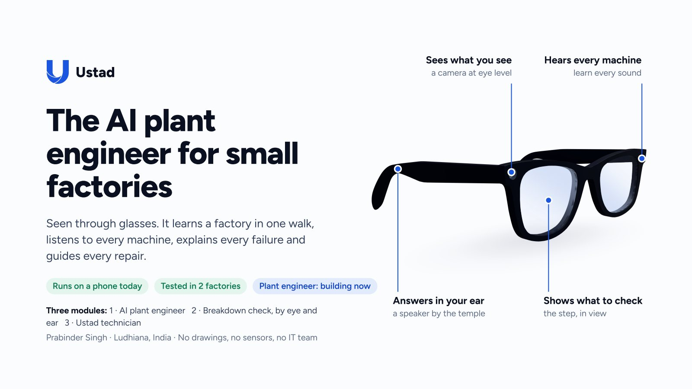
</p>

Prepared for the **GAVS hackathon**. This repository continues the original Ustad, built for the Meta Global AI
Developer Hackathon 2026, whose README is kept unchanged at [docs/README-meta-hackathon.md](docs/README-meta-hackathon.md).

> **Status, in one line.** The guided-work module (Module 3) is built, running and was tested in two Ludhiana factories.
> The plant engineer (Module 1) and the breakdown check (Module 2) are what we are building now. Every claim below is
> marked **built** or **building**, and no number is shown that wasn't measured.

---

## The problem

Walk into a powerloom unit, a flour mill, a paint factory or a small machine shop in Ludhiana, Surat or Coimbatore.
The machines are 10 to 30 years old. There are no sensors on them, no drawings of how they connect, and no
maintenance software. Repairs go in a register, if at all. So three things keep happening:

| | |
|---|---|
| **Breakdowns arrive without warning** | A bearing wears or a belt slips for days, and nobody hears it until the machine stops. |
| **Repairs are slow and expensive** | Whichever mechanic is free is called, the cause is found by trial and error, and parts are bought at any price. |
| **Knowledge walks out the door** | One senior worker knows how every machine behaves. New workers learn by mistakes, and those mistakes cause more breakdowns. |

Industry research puts **23%** of unplanned manufacturing downtime down to human error, against 9% in other sectors
(Vanson Bourne for ServiceMax, 2017). The world's 500 largest companies lose about **11%** of revenue to unplanned
downtime (Siemens, 2024). Small factories, with no maintenance team and no spare capacity, feel it far harder: every
day a machine is down is production they never get back, on margins that are already thin.

## Why today's systems don't solve it

Even a well-equipped plant, with a control system, ERP, maintenance software and engineers, handles a failure the
same slow way. **These systems store data, but they cannot explain it.**

- **The data is scattered.** Drawings, manuals, sensor trends, repair history and people's memory sit in different places.
- **Nothing explains.** A dashboard shows that pressure rose. It can't say why, or link it to a similar failure two years ago.
- **Investigation and action are manual.** Someone digs for hours, then raises the work order and orders parts by hand.
- **Knowledge isn't captured.** When the engineer who solved it leaves, the reasoning leaves too.

What's missing is a layer that connects all of it and reasons over it the way an experienced plant engineer does.
A small factory doesn't even have the systems to start from. **Ustad is that missing layer, built for factories that have none of them.**

<p align="center">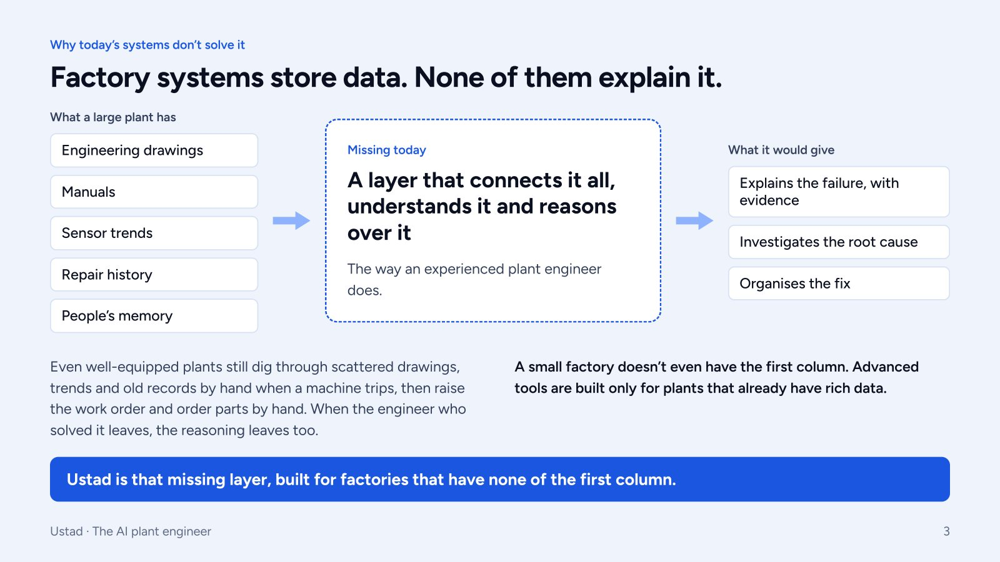</p>

---

## Three modules

Ustad is one assistant with three modules. All three share one factory knowledge graph, and run on smart glasses or,
today, on a phone clipped to the chest.

| Module | For | What it does | Status |
|---|---|---|---|
| **1 · AI plant engineer** | The owner | Knows every machine, explains why one failed with evidence, investigates the root cause and organises the repair, with the owner's approval | Building now |
| **2 · Breakdown check, by eye and ear** | Workers and mechanics | Look at a machine through the glasses or a phone and ask what's wrong. It listens to every machine and warns when the sound drifts | Building now |
| **3 · Ustad technician** | New technicians | An expert shows a job once. Ustad guides every new technician through it and checks each step on camera | **Built, tested in 2 factories** |

<p align="center">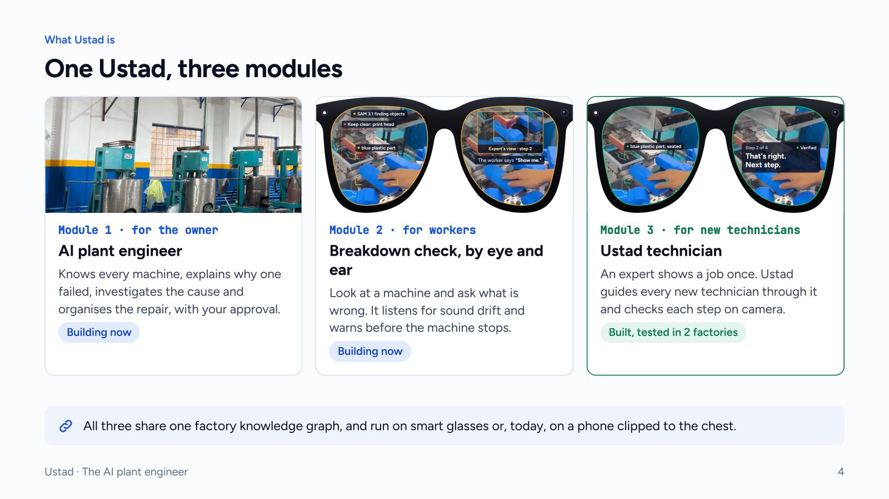</p>

### Built from what a small factory already has

| A traditional plant system needs | Ustad uses instead |
|---|---|
| Engineering drawings | One walk through the factory with the glasses on |
| An equipment database | Machine records built from nameplates, manuals, repair bills and the owner's voice notes |
| Plant sensors | Microphones that learn each machine's normal sound, and readings workers speak aloud |
| Maintenance software | Records Ustad writes itself from every check and repair |
| A control-room screen | The glasses: the answer appears where the worker looks. The owner gets a digital factory map |

## How it works

| Step | What happens | Status |
|---|---|---|
| **1. Learn the factory in one walk** | The owner walks the floor once and talks: *"This is the 2018 mixer, the motor was rewound in March."* Ustad reads each nameplate and builds a record for every machine: the digital factory map. It reuses the capture system that already turns a short recording into a checked job card in 20 to 38 seconds. | Building |
| **2. Listen to every machine** | The microphone learns each machine's healthy sound over its first days and flags drift early: a wearing bearing, a slipping belt, a loose mounting. Fully offline, no fault data needed. | Building |
| **3. Answer where you look** | Ask *"why did it stop?"* in Hindi (Punjabi next). Ustad reads the manual, checks the sound history and past repairs, and answers with the likely cause, the evidence, how sure it is and what to check first. A likely cause is never shown as a proven one. | Building |
| **4. Investigate, guide and verify** | For a serious failure it runs a full investigation and writes the root-cause report, then talks the mechanic through the fix and checks every step on camera. It drafts the ticket and parts order on WhatsApp; the owner approves every stop and payment. | Step checks **built** |
| **5. Prevent problems** | Camera-checked morning routines (oiling, belt tension, cleaning, safety) stop the operator mistakes behind many breakdowns, and train new workers on the job. | **Built** |
| **6. Learn from every repair** | Each verified repair saves the sound before failure, the cause and the fix together, so warnings improve in every factory that uses Ustad. | Data pipeline **built** |

For the owner, Ustad sends a short daily voice summary: which machines sound different, what service is due, and which repairs are waiting for approval.

<p align="center">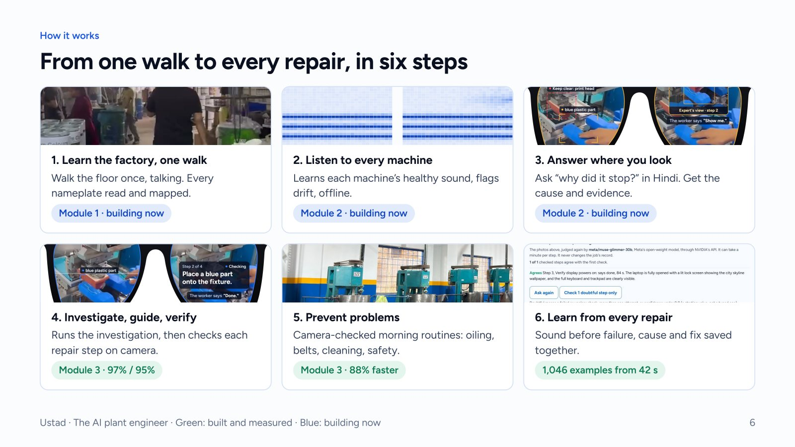</p>

---

## Module 1: the AI plant engineer

It does five things an experienced plant engineer does: **knows the plant, watches it, explains with evidence,
investigates like an engineer, and acts**, always waiting for the owner before money is spent or production stops.

<table>
  <tr>
    <td width="50%">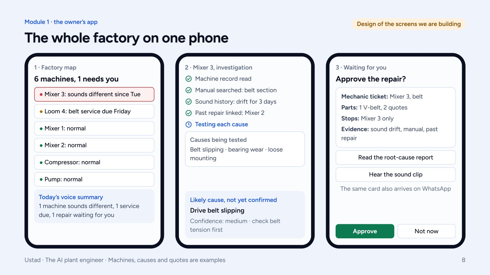</td>
    <td width="50%">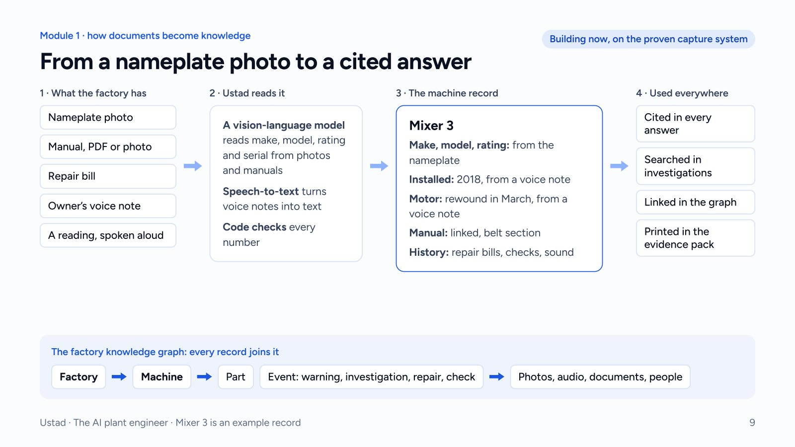</td>
  </tr>
  <tr>
    <td><sub><b>The owner's app</b> (screens we are designing; machines and causes are examples): the factory map, an investigation the owner can watch, and the approval card that also arrives on WhatsApp.</sub></td>
    <td><sub><b>From a nameplate photo to a cited answer</b>: a vision-language model reads make, model, rating and serial; speech-to-text reads voice notes; code checks every number; each record joins the factory knowledge graph.</sub></td>
  </tr>
</table>

## Module 2: the breakdown check, by eye and ear

**By eye.** A worker looks at a machine and asks *"यह मशीन क्यों रुकी?"* ("Why did this machine stop?"). Ustad reads
the record and the manual, pulls the sound history, links past incidents, tests each possible cause, and answers in
his ear: the likely cause, the evidence, the confidence and what to check first.

**By ear.** The method, designed to need no fault labels and to run on the device:

1. **Features.** 16 kHz audio is cut into short windows, each a log-mel spectrogram *x<sub>t</sub>*.
2. **Learn normal only.** A small autoencoder *f*, one per machine, learns its healthy sound over the first days.
3. **Score.** *s<sub>t</sub> = ‖x<sub>t</sub> − f(x<sub>t</sub>)‖²*, with the alert line τ set from that machine's own healthy windows.
4. **Decide.** Alert when *s<sub>t</sub> > τ* in 3 of the last 5 windows, so a one-off noise like a door slam is ignored. An embedding-distance baseline is compared too.

The detector will be benchmarked on the public industrial machine-sound datasets **MIMII** and **DCASE** (fans, pumps,
valves, slide rails), and the measured results reported here. Until then it is marked *building*.

<table>
  <tr>
    <td width="50%">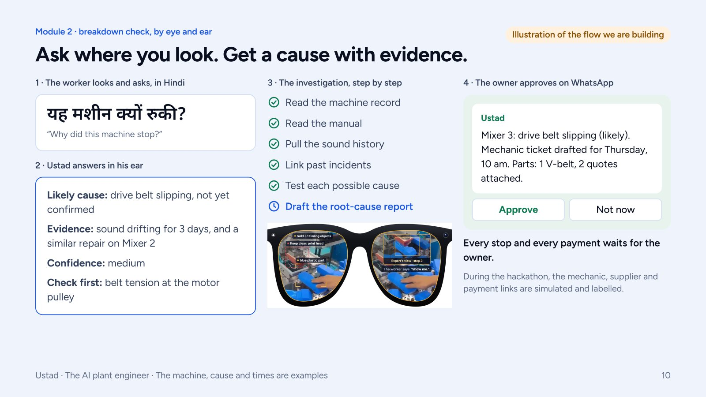</td>
    <td width="50%">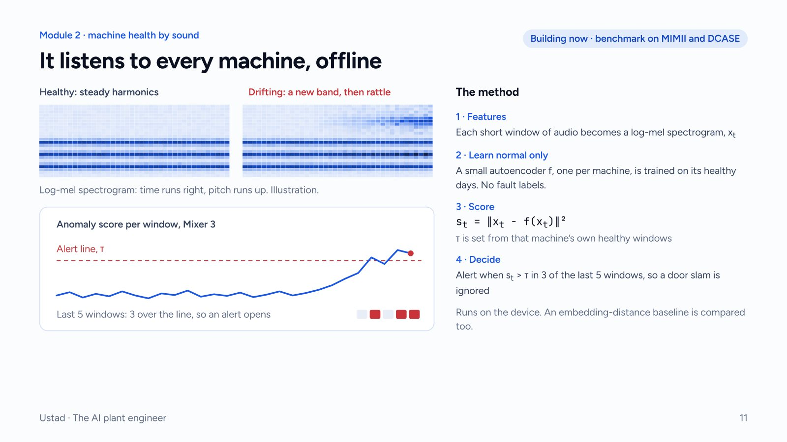</td>
  </tr>
  <tr>
    <td><sub>Illustration of the flow we are building. Mechanic, supplier and payment links will be simulated and labelled during the hackathon.</sub></td>
    <td><sub>Spectrograms and score chart are illustrations, not measured data.</sub></td>
  </tr>
</table>

## Module 3: the Ustad technician (built)

This is the part that runs today, and it is the code in this repository.

| | |
|---|---|
| **Capture** | The senior technician does the job once, talking it through. Ustad writes the job card: the order, the settings and torque values mentioned, a safety warning before each risky step, and what a finished step looks like to a camera. It checks every step against the footage before saving. |
| **Guide** | One spoken step at a time, with the part outlined live. Hands free: "done", "repeat", "where is it", "show me". |
| **Check** | On "done", SAM 3.1 finds the part and returns a box and a confidence; the reasoning model must commit to exactly one tool call: `verify_step`, `flag_error` or `request_better_view`. Guessing is not an option. |
| **Record** | Every check saves its photo, verdict and reason into a printable evidence pack. |
| **Safety, in code** | Lockout and hazard steps are never credited from a later view. A hand too close to a hazard gets a spoken warning. A request to skip a lockout goes to a supervisor. |

<table>
  <tr>
    <td align="center" width="50%">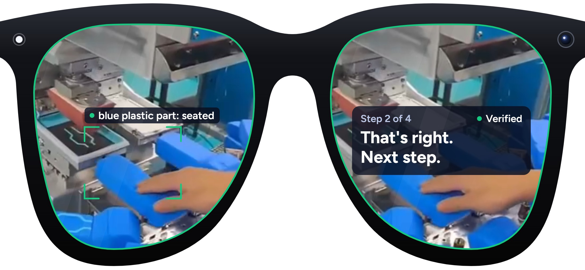<br /><sub>Through the glasses: the step is verified. Concept view over real factory footage.</sub></td>
    <td align="center" width="50%">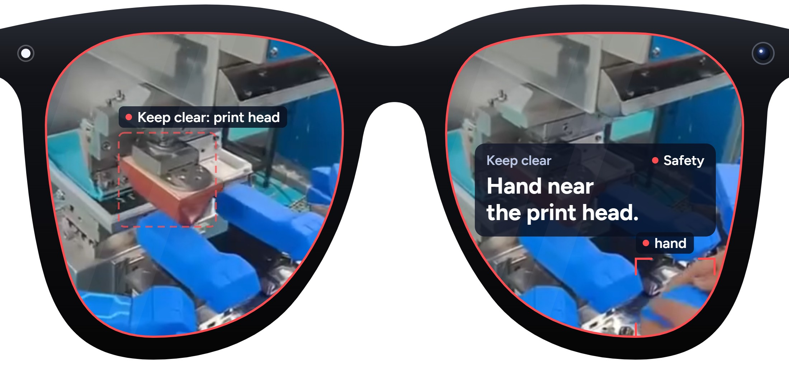<br /><sub>A hand near the print head: a spoken warning, and the job carries on.</sub></td>
  </tr>
</table>

<p align="center">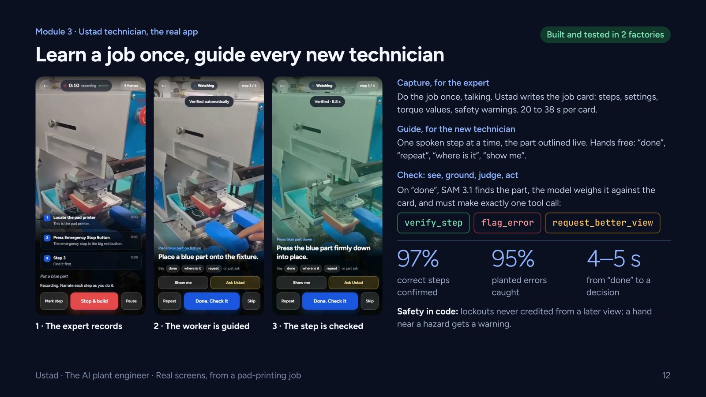<br /><sub>The real app screens, from a job on a pad-printing machine. Glasses are not tested yet; today the same app runs on a phone clipped to the chest.</sub></p>

---

## Architecture

### How one question flows

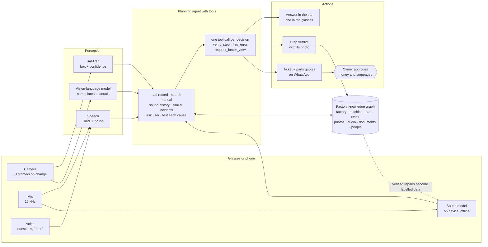

<p align="center">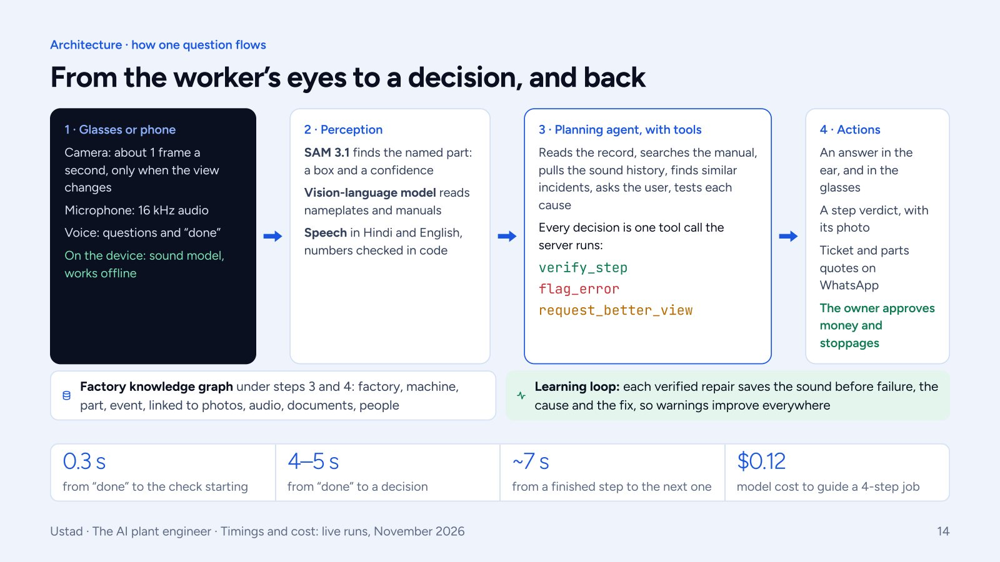</p>

### Six layers

| Layer | What it is | Status |
|---|---|---|
| **1 · Interface** | Smart glasses, or a phone clipped to the chest today in the browser, on the same backend. About 1 camera frame a second, only when the view changes; 16 kHz audio; entry-level Android; resumes at the exact step after a dropout. | Built (phone) |
| **2 · Perception** | SAM 3.1 open-vocabulary segmentation returns boxes with a confidence, so every decision rests on a visible fact. A vision-language model reads nameplates and manuals. Real-time speech in Hindi and English; numbers in translations are checked in code. | Mostly built |
| **3 · Machine health** | Log-mel windows; a per-machine autoencoder or embedding-distance model on the device; alerts at 3 of the last 5 windows; MIMII and DCASE benchmark. | Building |
| **4 · Reasoning and agent** | A planning agent with tool calls; each step decision is a single tool call the server executes; answers cite their records and label likely vs confirmed causes. Muse Glimmer, an open-weights model, can audit finished jobs. Procedures improve from real use with supervisor approval. | Partly built |
| **5 · Data** | The factory knowledge graph. Every check is an evidence record, collected into a printable evidence pack and a dashboard. With consent, labelled repair data is pooled to train fault classifiers. | Evidence built |
| **6 · Backend** | FastAPI with WebSocket streaming, a relational database, storage for evidence photos, sign-in with spending limits. Running the open model on one GPU on site, so checks work without the internet, is planned and not yet tested. | Built |

<p align="center">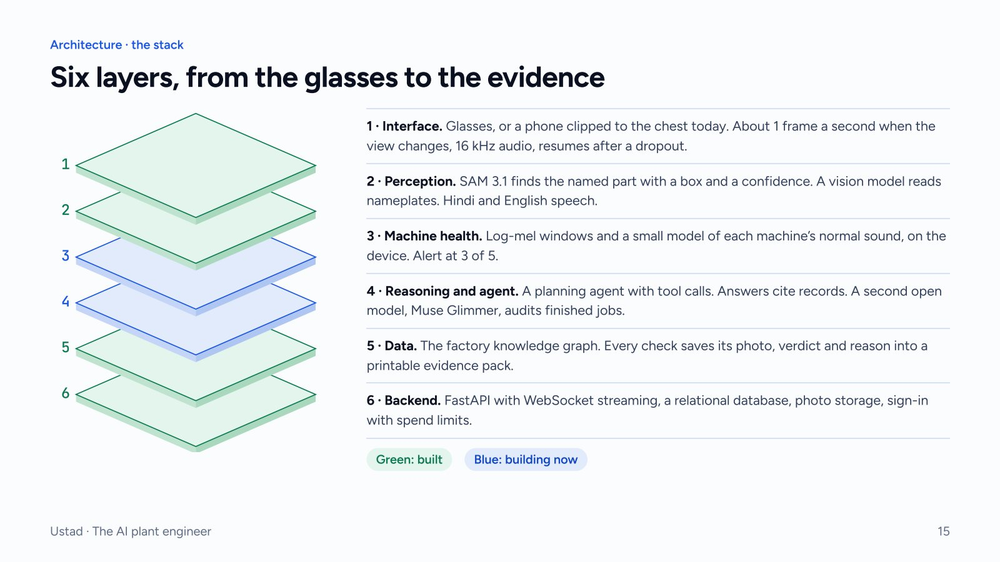</p>

The original system diagram and the one-check sequence diagram for Module 3 are in
[docs/README-meta-hackathon.md](docs/README-meta-hackathon.md#under-the-hood), and file-by-file detail is in
[docs/ARCHITECTURE.md](docs/ARCHITECTURE.md).

---

## Measured results

From the guided-work module (Module 3), at **PI Cottex Pvt Ltd** (textiles and clothing) and **MCPL, Modern Colours
Private Limited** (paints), both in Ludhiana. These come from guided jobs, **not** breakdown prediction, which we have
not measured yet.

| From the factory trials | |
|---|---|
| Correct steps confirmed by the camera check | **97%** |
| Deliberately planted errors caught | **95%** |
| New operators, against the current method | **88% faster** |
| Senior technicians, to a usable job card | **79% faster** |

| Speed and cost, live runs, November 2026 | |
|---|---|
| Short recording to a checked job card | 20 to 38 s |
| From saying "done" to the check starting | 0.3 s |
| From "done" to a decision | 4 to 5 s |
| Finished step to the next instruction | about 7 s |
| Model cost to record one job | about $0.09 |
| Model cost to guide a 4-step job | about $0.12 |
| Labelled training examples from one 42 s factory clip | 1,046 |

| 8 test cases, 4 deliberately wrong | Right | False passes |
|---|---|---|
| Main model (live) | 8 of 8 | 0 |
| Muse Glimmer, open weights, after the job | 8 of 8 | 0 |

<p align="center">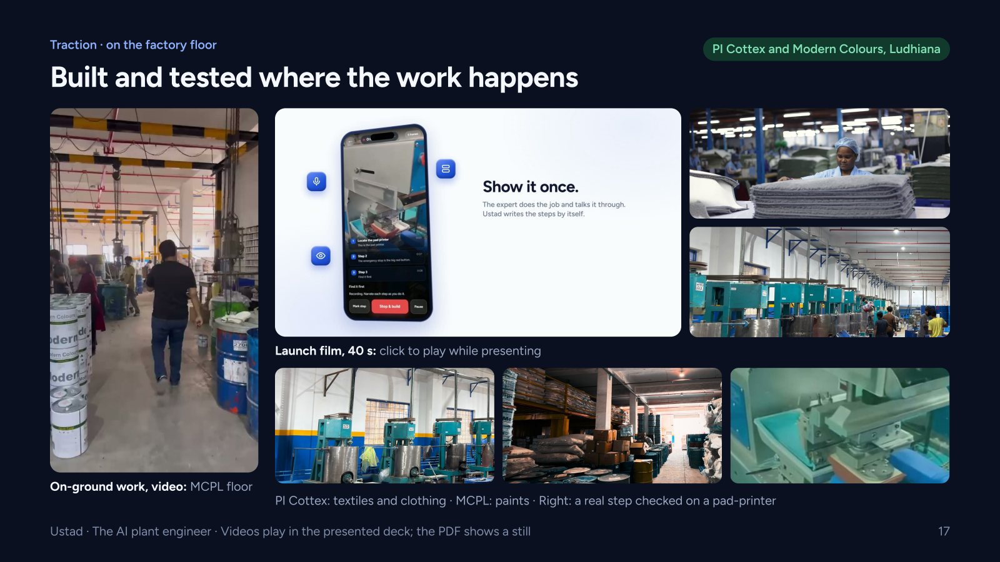</p>

### What we state openly

- **Glasses:** not tested yet. It runs on a chest-mounted phone today.
- **On-site checks:** camera checks use hosted models today; on-site deployment is planned and untested.
- **Second-model comparison:** only 8 test cases.
- **Hindi:** not yet tested against real accents in factory noise.
- **Costs:** model costs only, and approximate.
- **Integrations:** mechanic, supplier and payment links will be simulated and labelled during the hackathon.
- **Modules 1 and 2:** being built. Their figures will be reported here only once measured.

---

## Prototype plan

| Week | Work |
|---|---|
| **1** | Factory walkthrough, machine records and the digital factory map; sound baseline on recorded and live machines |
| **2** | Investigation agent with cited answers and root-cause reports; WhatsApp ticket and parts flow with approvals; Punjabi speech |
| **3** | Integration with the guided-repair module; benchmark on MIMII and DCASE |
| **4** | Pilot on real machines in a Ludhiana factory; measured results for the finale |

**Finale demo.** A worker looks at a machine whose sound we have changed, asks *"what's wrong with this?"*, gets the
likely cause and the evidence, watches the investigation complete step by step, is guided through the fix with each
step checked on camera, and the owner receives a WhatsApp approval card.

## Impact and business model

| | |
|---|---|
| **Owners** | Fewer surprise breakdowns, faster repairs, lower parts costs, and a record of every machine |
| **Workers** | On-the-job guidance and training in their own language, already shown to make new operators 88% faster |
| **Local mechanics** | Scheduled work with a clear diagnosis instead of emergency calls |
| **New jobs** | Trained "Ustad technicians" who set it up in each cluster |

- A monthly subscription per factory, priced per machine monitored.
- A small commission on parts and repairs ordered through Ustad.
- Glasses offered on rent within the subscription, with a phone as the free option.
- No installation and no IT team, so a factory can start in one afternoon. We start in Ludhiana, then go cluster by
  cluster: textiles, paint and chemicals, food processing, engineering workshops.

**Vision.** Every small factory in India gets an experienced plant engineer that never leaves. Today, Ustad guides
and checks work on the floor with measured results. Next, it listens to every machine and investigates every
breakdown. In the long run, the fault data it builds across thousands of factories lets India's small manufacturers
run with the reliability of the largest plants.

---

## Run it yourself

What runs today is Module 3, the guided-work module.

```bash
pip install -r requirements.txt
cp .env.example .env            # add your model API key as MODEL_API_KEY
python -m scripts.smoke_test    # checks each model works
uvicorn backend.main:app --host 0.0.0.0 --port 8000
```

```bash
python -m pytest tests/ -q      # no API key needed
```

Phones need HTTPS for the camera, so use a tunnel for testing: `cloudflared tunnel --url http://localhost:8000`.
With no `DEMO_ACCESS_CODE` set, local work has no sign-in. Full setup, the repo layout and the Muse Glimmer
configuration are in [docs/README-meta-hackathon.md](docs/README-meta-hackathon.md#run-it-yourself) and
[docs/RUNBOOK.md](docs/RUNBOOK.md).

Developers and coding agents: start with [AGENTS.md](AGENTS.md).

## Repository

| Path | What's there |
|---|---|
| [docs/gavs/](docs/gavs/) | The GAVS deck as a PDF, and the slide images used in this README |
| [docs/README-meta-hackathon.md](docs/README-meta-hackathon.md) | The original Ustad README, unchanged |
| `backend/`, `web/`, `scripts/`, `tests/`, `deploy/` | Module 3, the guided-work system, as built for the Meta hackathon |
| [docs/](docs/) | Architecture, decisions, runbook, status and timeline |

## Licence

Copyright (c) 2026 Prabinder Singh. All rights reserved.

This source is public so the hackathon's judges and organisers can review it. It isn't open source, and no licence to
reuse it is granted beyond what the hackathon's rules give the organisers. Open-source libraries it uses keep their own
licences.
